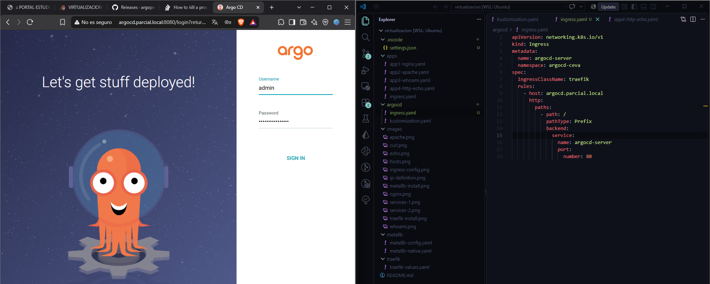
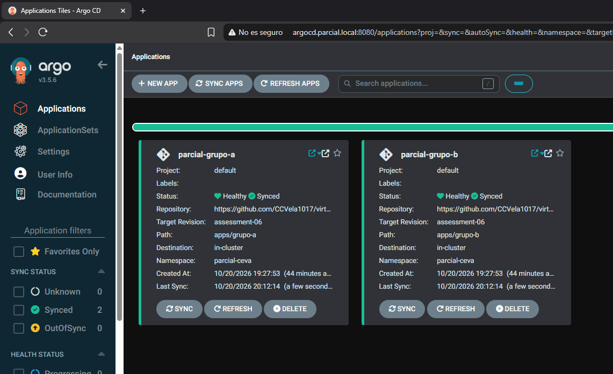
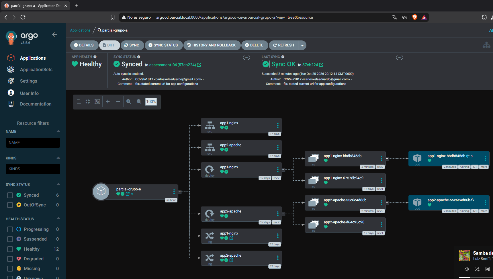
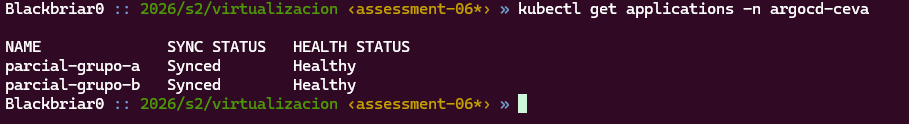

# Tarea 06 - ArgoCD

Despliegue GitOps de Argo CD sobre Minikube (WSL), expuesto con Traefik,
que sincroniza las aplicaciones del namespace `parcial-ceva` desde esta rama.

## 1. Instalación de Argo CD (namespace `argocd-ceva`)

Kustomize para reescribir el namespace del manifiesto oficial y activar `server.insecure`, ya que Traefik se comunica con Argo CD por HTTP.

```
kubectl create namespace argocd-ceva
kubectl apply -k argocd/ --server-side
kubectl wait --for=condition=ready pod --all -n argocd-ceva --timeout=300s
```

Contraseña inicial del usuario `admin`:

```bash
kubectl -n argocd-ceva get secret argocd-initial-admin-secret \
  -o jsonpath="{.data.password}" | base64 -d
```

## 2. Exposición por Traefik

El Ingress `argocd/ingress.yaml` publica el servicio `argocd-server` en
`argocd.parcial.local`. El dominio se agrega a `/etc/hosts`.

```bash
LB_IP=$(kubectl get svc traefik -n traefik -o jsonpath='{.status.loadBalancer.ingress[0].ip}')
echo "$LB_IP argocd.parcial.local" | sudo tee -a /etc/hosts
kubectl apply -f argocd/ingress.yaml
```

Para acceder desde el navegador de Windows se usa un port-forward hacia
Traefik y `127.0.0.1 argocd.parcial.local` en el archivo hosts de Windows:

```bash
kubectl port-forward -n traefik svc/traefik 8080:80
```

URL: `http://argocd.parcial.local:8080`



## 3. Conexión al repositorio

El repositorio es publico, por lo que se registra con un Secret
declarativo (`argocd/repo.yaml`):

```bash
kubectl apply -f argocd/repo.yaml
```

## 4. Applications

Se crearon dos Applications que apuntan a la rama `assessment-06`:

| Application | Ruta | Apps |
|---|---|---|
| `parcial-grupo-a` | `apps/grupo-a` | app1-nginx, app2-apache |
| `parcial-grupo-b` | `apps/grupo-b` | app3-whoami, app4-echo |

```bash
kubectl apply -f argocd/applications/
```

## 5. Verificacion: cambio en el repositorio

Estado inicial (`app1-nginx` con 1 réplica):




Cambio realizado: `replicas: 1` - `replicas: 3` en
`apps/grupo-a/app1-nginx.yaml`, con commit y push a `assessment-06`.

Estado final, sincronizado automáticamente por Argo CD:


