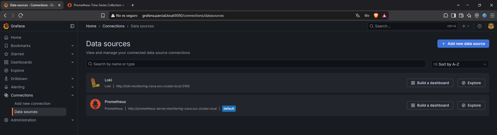
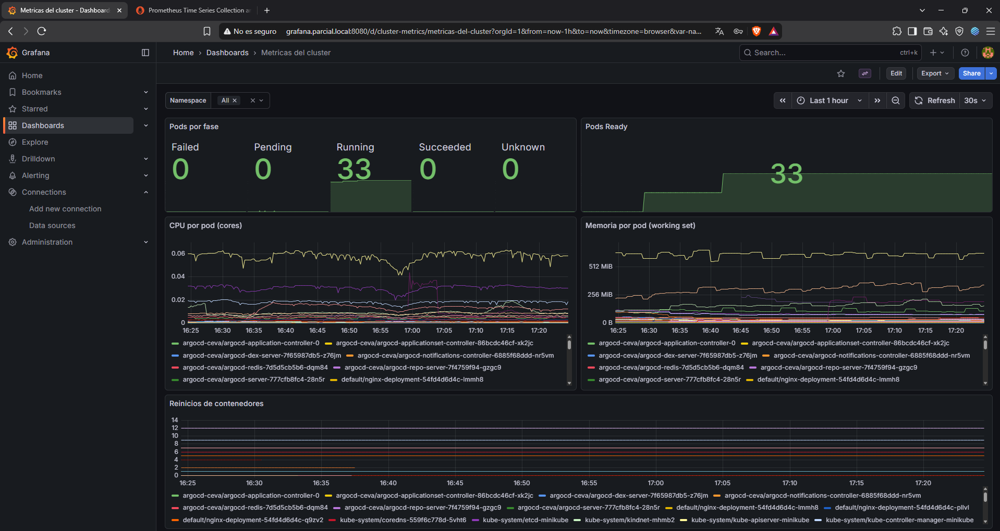
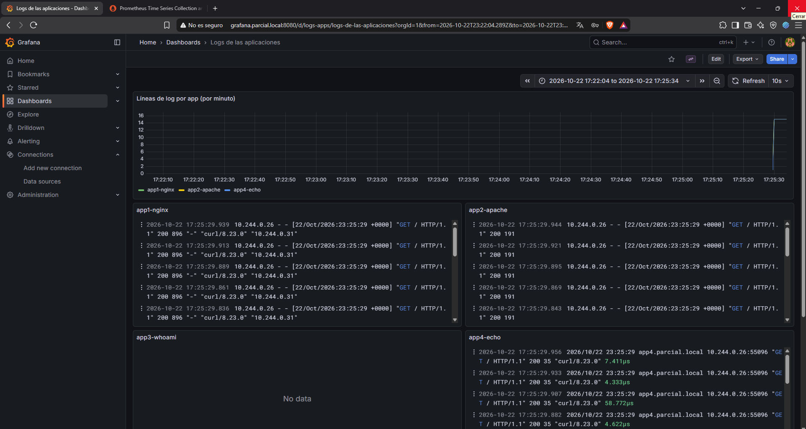
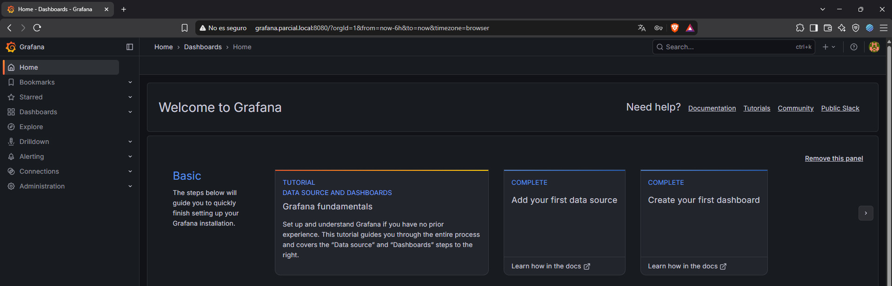
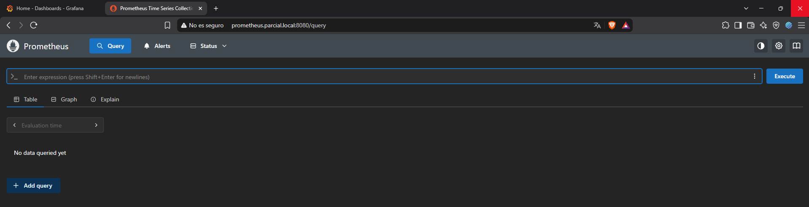
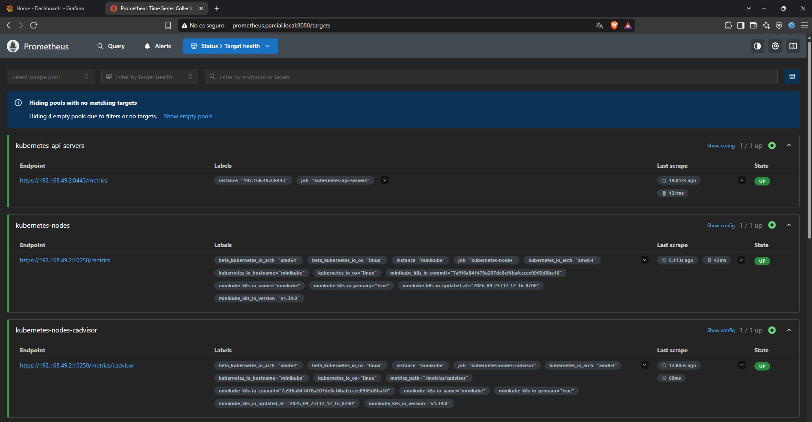

# Proyecto Personal I - Monitoreo

## Componentes y versiones

| Componente | Chart de Helm | Version del chart | Values |
|---|---|---|---|
| Prometheus | `prometheus-community/prometheus` | 3.15.1 | `monitoring/values/prometheus-values.yaml` |
| Loki | `grafana/loki` | 3.6.16 | `monitoring/values/loki-values.yaml` |
| Promtail | `grafana/promtail` | 3.5.1 | `monitoring/values/promtail-values.yaml` |
| Grafana | `grafana/grafana` | 12.3.1 | `monitoring/values/grafana-values.yaml` |

## Estructura del repositorio

```
monitoring/
├── values/                       
├── grafana/
│   ├── dashboards/               
│   └── dashboard-*-cm.yaml       
└── ingress/
    └── monitoring-ingress.yaml   
```

## 1. Preparacion

```bash
kubectl create namespace monitoring-ceva

helm repo add prometheus-community https://prometheus-community.github.io/helm-charts
helm repo add grafana https://grafana.github.io/helm-charts
helm repo update
```

## 2. Instalacion de Prometheus

```bash
helm install prometheus prometheus-community/prometheus \
  -n monitoring-ceva -f monitoring/values/prometheus-values.yaml
```

## 3. Instalacion de Loki

```bash
helm install loki grafana/loki \
  -n monitoring-ceva -f monitoring/values/loki-values.yaml
```

## 4. Promtail y recolección de logs

Se recolectan los logs de todo el cluster, incluidas las 4 aplicaciones de `parcial-ceva` y Traefik.

```yaml
config:
  clients:
    - url: http://loki.monitoring-ceva.svc.cluster.local:3100/loki/api/v1/push
```

```bash
helm install promtail grafana/promtail \
  -n monitoring-ceva -f monitoring/values/promtail-values.yaml
```

Las apps se identifican en Loki con las etiquetas `app`:
`app1-nginx`, `app2-apache`, `app3-whoami` y `app4-echo`.

## 5. Grafana y data sources (provisioning)

Los data sources se definen como código en `monitoring/values/grafana-values.yaml`,
bajo `datasources`.

| Data source | Tipo | uid | URL |
|---|---|---|---|
| Prometheus (default) | `prometheus` | `prometheus` | `http://prometheus-server.monitoring-ceva.svc.cluster.local` |
| Loki | `loki` | `loki` | `http://loki.monitoring-ceva.svc.cluster.local:3100` |

```bash
helm install grafana grafana/grafana \
  -n monitoring-ceva -f monitoring/values/grafana-values.yaml
```

La contraseña de `admin` la genera el chart y no se guarda en el repositorio:

```bash
kubectl get secret grafana -n monitoring-ceva \
  -o jsonpath="{.data.admin-password}" | base64 -d
```



## 6. Dashboards como código

Los dashboards son archivos JSON en `monitoring/grafana/dashboards/`.

| Dashboard | Contenido |
|---|---|
| Métricas del clúster | CPU y memoria por pod, pods por fase, pods Ready y reinicios |
| Logs de las aplicaciones | Volumen de logs por app y un panel de logs por cada una de las 4 apps, más Traefik |

```bash
kubectl apply -f monitoring/grafana/dashboard-cluster-metrics-cm.yaml \
              -f monitoring/grafana/dashboard-logs-apps-cm.yaml
```




## 7. Exposición por Traefik y DNS local

`monitoring/ingress/monitoring-ingress.yaml` define dos Ingress con
`ingressClassName: traefik`:

- `grafana.parcial.local` → servicio `grafana`
- `prometheus.parcial.local` → servicio `prometheus-server`

```bash
kubectl apply -f monitoring/ingress/monitoring-ingress.yaml
```

Los dominios se agregan a `/etc/hosts` apuntando a la IP del LoadBalancer de
Traefik (asignada por MetalLB):

```bash
LB_IP=$(kubectl get svc traefik -n traefik -o jsonpath='{.status.loadBalancer.ingress[0].ip}')
echo "$LB_IP grafana.parcial.local"    | sudo tee -a /etc/hosts
echo "$LB_IP prometheus.parcial.local" | sudo tee -a /etc/hosts
```

Para acceder desde el navegador de Windows se usa un port-forward hacia
Traefik y `127.0.0.1` en el archivo hosts de Windows:

```bash
kubectl port-forward -n traefik svc/traefik 8080:80
```




## 8. Targets de Prometheus

Todos los targets están en estado `UP`:


